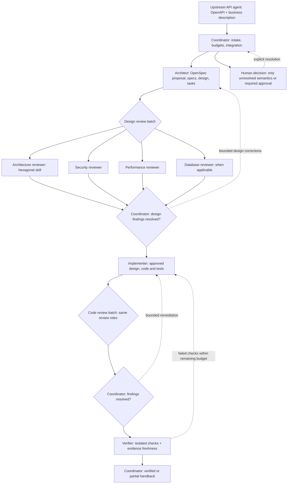

# Subagent graph

Solid arrows show work/artifact handoffs; dotted arrows show feedback. The coordinator owns integration. Review roles run in separate contexts when supported and share one frozen snapshot, without write access. The upstream agent is an external producer, not a child of this skill.

Gate-to-implementation and gate-to-verification edges require successful mandatory verdicts. Any stage may stop with partial output, a decision request or failed verification. The coordinator reroutes changed designs to design review. A database review marked not applicable requires an explicit scope reason, so its absence cannot silently bypass the batch.

| Role | Prompt | Writable artifacts |
| --- | --- | --- |
| Architect | [architect.md](prompts/architect.md) | Assigned OpenSpec change |
| Implementer | [implementer.md](prompts/implementer.md) | Assigned source, tests, migrations |
| Architecture reviewer | [architecture-reviewer.md](prompts/architecture-reviewer.md) | Findings only |
| Security reviewer | [security-reviewer.md](prompts/security-reviewer.md) | Findings only |
| Performance reviewer | [performance-reviewer.md](prompts/performance-reviewer.md) | Findings only |
| Database reviewer | [database-reviewer.md](prompts/database-reviewer.md) | Findings only |
| Verifier | [verifier.md](prompts/verifier.md) | Check outputs/evidence only |

For each dispatch use `delegation.md` + the role prompt + a populated task envelope. Role prompts alone do not carry task-specific permissions or inputs.
